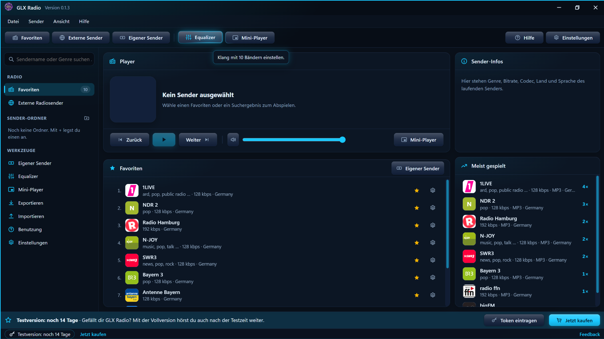
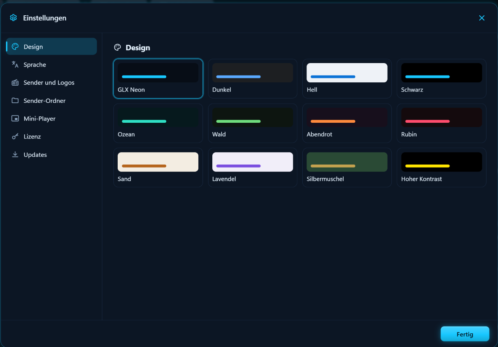
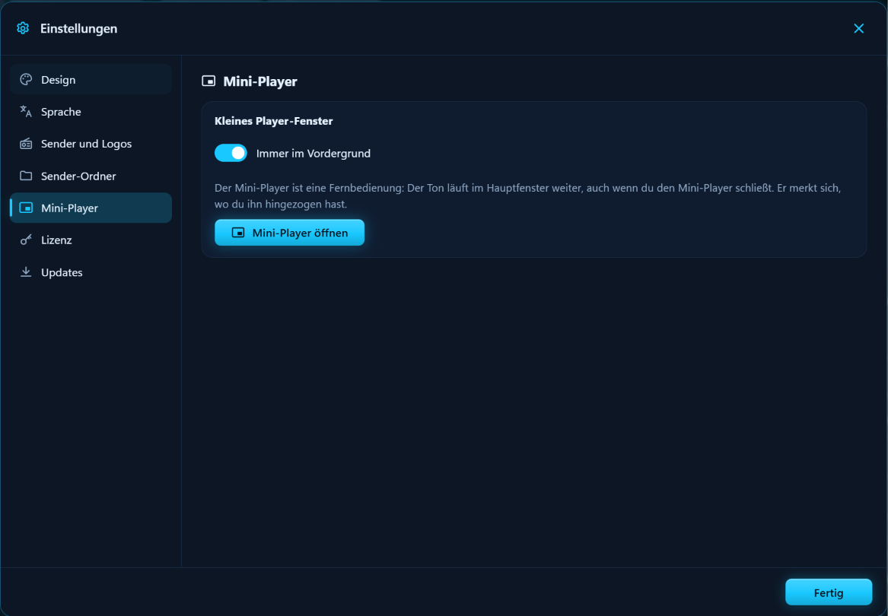
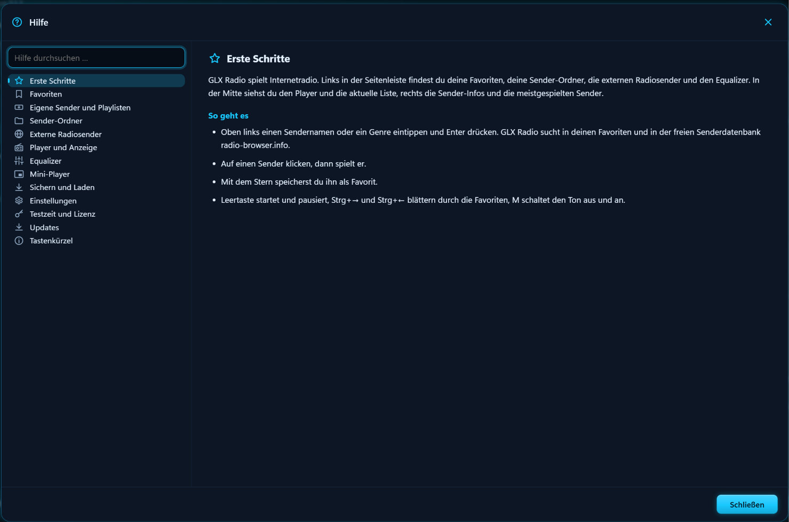
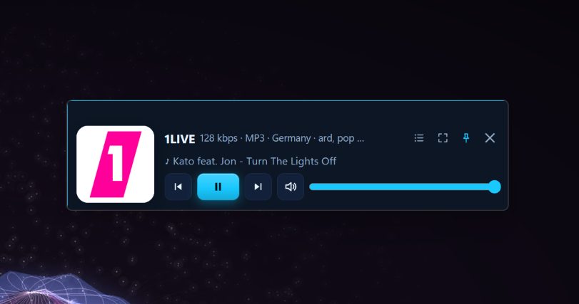
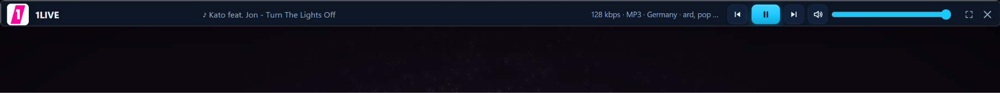

🌍 Sprachen: [🇺🇸 English](README.md) | [🇩🇪 Deutsch](README.de.md)

# 💠 GLX Radio Windows

### Internetradio ohne Browser.

*Deine Lieblingssender im eigenen Player, dazu Tausende weitere aus radio-browser.info.* ⚡

   

---

## ⬇️ Download

👉 Neueste Version: [Releases](../../releases/latest)  
👉 Shop und Lizenzen: [glx-tools.de](https://glx-tools.de/product/glx-radio-windows/)

---

## 📸 Überblick & Screenshots

### 1️⃣ Hauptfenster

### 2️⃣ Ansicht 2

### 3️⃣ Ansicht 3

### 4️⃣ Ansicht 4

### 5️⃣ Ansicht 5

### 6️⃣ Ansicht 6

---

## ✨ Funktionen

- 🚀 **Eigenständiger Player:** Radio direkt im eigenen Programm, ohne Browser-Tab und ohne Nextcloud.
- 🧩 **Sofort startklar:** Zehn geprüfte deutsche Sender sind beim ersten Start schon als Favoriten eingerichtet.
- ⚙️ **Tausende Sender:** Suche nach Sendername oder Genre in der freien Datenbank radio-browser.info.
- 🔒 **Drei Player-Größen:** Großer Player, kompakter Mini-Player und ein schmaler Leisten-Player, der oben am Bildschirm andockt.
- 📂 **Empfangsdaten live:** Bitrate, Codec, Land und Genre werden beim Hören angezeigt.
- ⚡ **Ladering:** Ein Ring um das Senderlogo zeigt, dass ein Sender gerade verbindet.
- 🎨 **Favoriten:** Deine eigene Senderliste für den schnellen Zugriff.
- 🌍 **12 Designs:** Mit passenden Fensterrahmen, von GLX Neon bis zu hellen Designs.
- 🛠️ **Zwei Sprachen:** Deutsch und Englisch mit eingebauter Hilfe.
- 📊 **14 Tage testen:** Alle Funktionen 14 Tage kostenlos, danach Freischaltung mit einem Lizenz-Token.

---

## 🧩 Systemanforderungen

- Windows 10 oder Windows 11 (64-Bit)

---

## 🧪 Testzeitraum & Lizenz

Alle Funktionen 14 Tage kostenlos, danach Lizenz-Token von [glx-tools.de](https://glx-tools.de).

---

## 🔗 Mehr zu diesem Produkt

👉 [glx-tools.de](https://glx-tools.de/product/glx-radio-windows/)  
Support: **info@glx-tools.de**

---

## 📄 Lizenz

Copyright © 2026 GLX Tools – Gordon Lehmann. Alle Rechte vorbehalten.  
Dies ist proprietäre kommerzielle Software. Es wird keine Open-Source-Lizenz gewährt. Dieses Repository enthält nur Release-Downloads und Dokumentation; der Quelltext wird nicht veröffentlicht.

---

Mit ❤️ gemacht von **Dreamdancer100**

